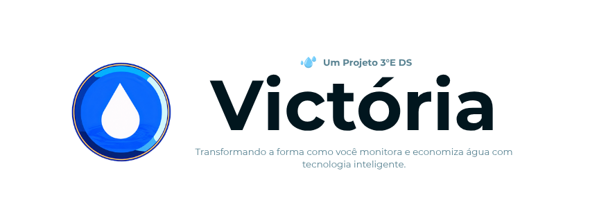
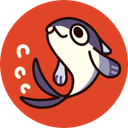
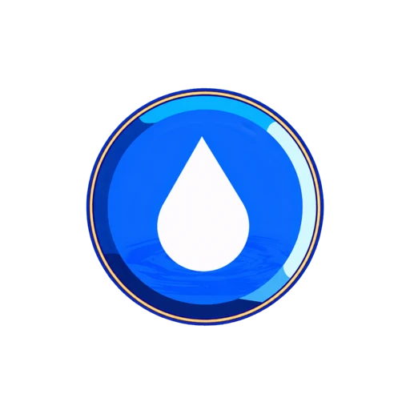

<p align="center">
  
</p>

<br>

<h1 align="center">🌊 Projeto Victoria</h1>

<p align="center">
  <b>Sistema de Monitoramento Inteligente de Consumo de Água</b>
</p>

<br>

<p align="center">
  
  
  
</p>

<br>

<p align="center">
  <a href="#-sobre">📖 Sobre</a> <b>·</b>
  <a href="#-status">📌 Status</a> <b>·</b>
  <a href="#-layout">🎨 Layout</a> <b>·</b>
  <a href="#-funcionalidades">✨ Funcionalidades</a> <b>·</b>
  <a href="#-tech-stack">🛠 Tecnologias e Ferramentas</a> <b>·</b>
  <a href="#-arquitetura">🏗 Arquitetura</a> <b>·</b>
  <a href="#-executar">🚀 Executar</a> <b>·</b>
  <a href="#-banco">🗄 Banco</a> <b>·</b>
  <a href="#-api">🧭 API</a> <b>·</b>
  <a href="#-seguranca">🛡 Segurança</a> <b>·</b>
  <a href="#-desenvolvedores">👥 Devs</a> <b>·</b>
  <a href="#-agradecimentos">🙏 Agradecimentos</a>
</p>

<br>

---

<br>

<h2 id="-sobre" align="center">📖 Sobre</h2>

<p align="center">
  O <strong>Victoria</strong> nasceu como Trabalho de Conclusão de Curso da <strong>Etec Lauro Gomes</strong> — uma plataforma web que une tecnologia <strong>IoT</strong>, design moderno e conscientização ambiental para transformar a forma como monitoramos o consumo de água.
</p>

<p align="center">
  O site, a partir da Dashboard, é possível calcular tarifas com base em <strong>8 categorias tarifárias progressivas</strong>, e apresentar tudo em uma interface bonita, responsiva e interativa. Cada detalhe foi pensado para educar e engajar o usuário na causa da sustentabilidade hídrica. 
</p>

<br>

<table align="center">
  <tr>
    <td align="center"></td>
    <td align="center"></td>
  </tr>
</table>

<br>

---

<br>

<h2 id="-status" align="center">📌 Status</h2>

<p align="center">
  <blockquote>
    <strong>Versão:</strong> Versão 0.9.5 - Subaru<br>
    <strong>Última Atualização:</strong> Outubro de 2026<br>
    <strong>Status:</strong> Em Andamento
  </blockquote>
</p>

<p align="center">
  O desenvolvimento principal do Victoria está em andamento, com todas as funcionalidades planejadas sendo implementadas. O projeto encontra-se estável e pronto para demonstração local <3
</p>

<br>

<p align="center">
  <blockquote>
    🔔 <strong>Nota:</strong> Funcionalidades de <strong>recuperação de senha</strong> e <strong>verificação de e-mail</strong> serão implementadas futuramente.
  </blockquote>
</p>

<br>

---

<br>

<h2 id="-layout" align="center">🎨 Layout</h2>

<p align="center">
  O Victoria foi projetado com uma identidade visual única — combinando <strong>glassmorphism</strong>, paleta de azul-petróleo (<code>#01161e</code> · <code>#124559</code> · <code>#598392</code> · <code>#aec3b0</code> · <code>#eff6e0</code>) e tipografia Montserrat para criar uma experiência que transmite frescor, tecnologia e confiança.
</p>

<br>

<p align="center">
  <blockquote>
    🎬 <strong>Bônus:</strong> O sistema conta com uma <strong>splash screen animada</strong>, inspirada na movimentação fluída da água. 
  </blockquote>
</p>

<br>

<p align="center">
  <blockquote>
    🌗 <strong>Novidade da v0.9:</strong> O Victoria agora também tem <strong>modo escuro</strong> completo — transição suave entre os temas, preferência salva no navegador e detecção automática da configuração do sistema.
  </blockquote>
</p>

<br>

---

<br>

<h2 id="-funcionalidades" align="center">✨ Funcionalidades</h2>

<br>

<table align="center">
  <tr>
    <td align="center" width="33%">
      <h3 align="center">📊 Dashboard</h3>
      <p align="center">Calculadora de consumo com <strong>8 categorias tarifárias</strong> e faixas progressivas. Dados com ApexCharts.</p>
    </td>
    <td align="center" width="33%">
      <h3 align="center">📈 Relatórios</h3>
      <p align="center"><strong>6 gráficos</strong> interativos com KPIs, mini-stats e exportação para <strong>PDF estilizado</strong> (html2canvas + jsPDF).</p>
    </td>
    <td align="center" width="33%">
      <h3 align="center">👤 Perfil</h3>
      <p align="center">Avatar, banner customizável com <strong>CropperJS</strong>, metas pessoais, mini-gráfico e sidebar de atividade.</p>
    </td>
  </tr>
  <tr>
    <td align="center">
      <h3 align="center">🔐 Autenticação</h3>
      <p align="center">Login seguro com <strong>sessão PHP</strong>, cookie HTTP-only SameSite Lax, 3 níveis de acesso: Usuário / Admin / Corporativo.</p>
    </td>
    <td align="center">
      <h3 align="center">📰 Notícias</h3>
      <p align="center">Painel de notícias com categorias, destaques, <strong>upload de imagens</strong> e modal de leitura com avatar do autor.</p>
    </td>
    <td align="center">
      <h3 align="center">⚙️ Admin</h3>
      <p align="center">Painel completo: gestão de <strong>usuários, empresas, logs</strong> e estatísticas do sistema com gráficos.</p>
    </td>
  </tr>
  <tr>
    <td align="center">
      <h3 align="center">📱 Responsivo</h3>
      <p align="center">Layout adaptável em <strong>4 breakpoints</strong>: 1200px, 768px, 480px e 400px. Cobertura total mobile.</p>
    </td>
    <td align="center">
      <h3 align="center">🎬 Animação</h3>
      <p align="center"><strong>Splash screen</strong> de entrada com partículas animadas, transições CSS fluidas e identidade visual marcante.</p>
    </td>
    <td align="center">
      <h3 align="center">🎯 Metas</h3>
      <p align="center">Sistema de <strong>metas personalizadas</strong> de consumo com projeção mensal e barras de progresso inteligentes.</p>
    </td>
  </tr>
  <tr>
    <td align="center">
      <h3 align="center">🌗 Modo Escuro</h3>
      <p align="center">Tema claro/escuro completo com <strong>crossfade suave</strong>, preferência salva no navegador e detecção automática do sistema.</p>
    </td>
    <td align="center">
      <h3 align="center">📚 Documentação</h3>
      <p align="center">Página de documentação com <strong>6 fichamentos em PDF</strong> para visualizar e baixar direto do site.</p>
    </td>
    <td align="center">
      <h3 align="center">📜 Termos de Serviço</h3>
      <p align="center">Página de <strong>Termos e Ética</strong> linkada no rodapé e aceite obrigatório durante o cadastro.</p>
    </td>
  </tr>
</table>

<br>

---

<br>

<h2 id="-tech-stack" align="center">🛠 Tecnologias e Ferramentas</h2>

<p align="center">
  Abaixo estão as principais tecnologias, linguagens, bibliotecas e ferramentas utilizadas no desenvolvimento do nosso site:
</p>

<br>

<h3 align="center">💻 Linguagens de Programação e Marcação</h3>

<p align="center">
  
  
  
  
</p>

<br>

<h3 align="center">🗄️ Banco de Dados</h3>

<p align="center">
  
</p>

<br>

<h3 align="center">📚 Bibliotecas e Componentes</h3>

<p align="center">
  
  
  
  
  
  
</p>

<br>

<h3 align="center">🧰 Ferramentas de Desenvolvimento</h3>

<p align="center">
  
  
  
  
  
</p>

<br>

<h3 align="center">🔧 Back-end</h3>

<table align="center">
  <tr>
    <th align="center">Tecnologia</th>
    <th align="center">Aplicação</th>
  </tr>
  <tr>
    <td align="center"><strong>PHP 8.0+</strong></td>
    <td align="center">API REST sem frameworks, roteamento manual e componentes reutilizáveis</td>
  </tr>
  <tr>
    <td align="center"><strong>PDO</strong></td>
    <td align="center">Prepared Statements e conexão segura com MySQL</td>
  </tr>
  <tr>
    <td align="center"><strong>Sessão PHP</strong></td>
    <td align="center">Autenticação com cookie HTTP-only, SameSite Lax e validade de 30 dias</td>
  </tr>
  <tr>
    <td align="center"><strong>POO</strong></td>
    <td align="center">CRUD administrativo orientado a objetos — <code>ControladorAdminCrud</code> abstrato + controllers no namespace <code>Victoria\Admin</code></td>
  </tr>
</table>

<br>

<h3 align="center">⚙️ Middleware</h3>

<table align="center">
  <tr>
    <th align="center">Arquivo</th>
    <th align="center">Função</th>
  </tr>
  <tr>
    <td align="center"><code>verificador-base.php</code></td>
    <td align="center">Inicializa sessão longa de 30 dias e utiliza a pasta própria <code>sessions/</code></td>
  </tr>
  <tr>
    <td align="center"><code>configuracao-sessao.php</code></td>
    <td align="center">Configura o cookie de sessão (HTTP-only, SameSite Lax, secure em HTTPS) e a pasta <code>sessions/</code></td>
  </tr>
  <tr>
    <td align="center"><code>renderizar-acesso-negado.php</code></td>
    <td align="center">Renderiza a página estilizada <strong>403 Acesso Restrito</strong> quando o middleware admin bloqueia a requisição</td>
  </tr>
  <tr>
    <td align="center"><code>verificador.php</code></td>
    <td align="center">Bloqueia acesso não autenticado com resposta JSON 401 ou redirecionamento</td>
  </tr>
  <tr>
    <td align="center"><code>verificador-admin.php</code></td>
    <td align="center">Bloqueia acesso não administrativo (<code>tipo_usuario !== 2</code>)</td>
  </tr>
  <tr>
    <td align="center"><code>verificador-sessao.php</code></td>
    <td align="center">Endpoint JSON leve para o front-end verificar a sessão ativa</td>
  </tr>
  <tr>
    <td align="center"><code>verificador-csrf.php</code></td>
    <td align="center">Validação de token CSRF em requisições que alteram dados</td>
  </tr>
</table>

<br>

---

<br>

<h2 id="-arquitetura" align="center">🏗 Arquitetura</h2>

<p align="center">
  O projeto segue uma arquitetura MVC simplificada, com separação clara entre camada de apresentação (PHP + HTML), lógica de negócio (API REST) e dados (MySQL via PDO).
</p>

<br>

```
Victoria/
│
├── 📁 api/
│   ├── 📁 auth/
│   ├── 📁 gastos/
│   ├── 📁 noticias/
│   ├── 📁 usuarios/
│   ├── 📁 admin/
│   │   └── 📁 controllers/    # CRUD OOP (ControladorAdminCrud)
│   ├── 📁 middleware/
│   ├── 📁 services/           # ServicoUpload (imagens)
│   └── 📁 config/
│
├── 📁 public/
│   ├── 📁 pages/
│   │   └── 📁 admin/           # Abas do painel administrativo
│   ├── 📁 components/
│   ├── 📁 helpers/
│   └── 📁 assets/
│       ├── 📁 css/
│       ├── 📁 js/
│       ├── 📁 img/
│       └── 📁 docs/            # Fichamentos em PDF
│
├── 📁 database/
├── 📁 sessions/
├── 📁 tools/
├── 📁 tests/
└── 📁 docs/
```

<br>

<p align="center">
  <blockquote>
    🧩 <strong>Camadas da v0.9:</strong> o painel admin usa <strong>CRUD orientado a objetos</strong> (<code>ControladorAdminCrud</code> abstrato + <code>ControladorNoticias</code>, <code>ControladorEmpresas</code> e <code>ControladorLogs</code>); o upload de imagens fica isolado no serviço <code>ServicoUpload</code> (<code>api/services/</code>); e o helper <code>caminhos.php</code> resolve URLs e capas de notícias com fallback seguro.
  </blockquote>
</p>

---

<br>

<h2 id="-executar" align="center">🚀 Executar</h2>

<p align="center">
  Siga os passos abaixo para rodar o Victoria no seu ambiente local.
</p>

<br>

<h3 align="center">📋 Pré-requisitos</h3>

<table align="center">
  <tr>
    <th align="center" width="50%">🪟 Windows / 🐧 Linux</th>
    <th align="center" width="50%">🍎 macOS</th>
  </tr>
  <tr>
    <td><b>XAMPP</b> (PHP 8.0+, MySQL 8.0+)</td>
    <td><b>MAMP</b> ou <b>XAMPP</b> (PHP 8.0+, MySQL 8.0+)</td>
  </tr>
  <tr>
    <td>Servidor <b>Apache</b> rodando</td>
    <td>Servidor <b>Apache</b> rodando</td>
  </tr>
  <tr>
    <td><b>phpMyAdmin</b> ou cliente MySQL</td>
    <td><b>phpMyAdmin</b> ou cliente MySQL</td>
  </tr>
</table>

<br>

<h3 align="center">👣 Passo a Passo</h3>

<br>

<details>
  <summary><strong>🪟 Windows</strong> (XAMPP em <code>C:\xampp\htdocs\</code>)</summary>

  <br>

  ```bash
  # 1️⃣ Clone o repositório
  git clone https://github.com/seu-usuario/Victoria.git

  # 2️⃣ Mova para a pasta do XAMPP
  move Victoria C:\xampp\htdocs\

  # 3️⃣ Importe o banco de dados
  #    phpMyAdmin → Importar → database/victoria.sql

  # 4️⃣ Configure a conexão
  #    Edite api\config\conexao.php com suas credenciais MySQL

  # 5️⃣ Acesse no navegador
  #    http://localhost/Victoria/public/
  ```

</details>

<br>

<details>
  <summary><strong>🐧 Linux</strong> (XAMPP em <code>/opt/lampp/htdocs/</code>)</summary>

  <br>

  ```bash
  # 1️⃣ Clone o repositório
  git clone https://github.com/seu-usuario/Victoria.git

  # 2️⃣ Mova para a pasta do XAMPP
  sudo mv Victoria /opt/lampp/htdocs/

  # 3️⃣ Importe o banco de dados
  #    phpMyAdmin (http://localhost/phpmyadmin) → Importar → database/victoria.sql

  # 4️⃣ Configure a conexão
  #    Edite api/config/conexao.php com suas credenciais MySQL

  # 5️⃣ Acesse no navegador
  #    http://localhost/Victoria/public/
  ```

</details>

<br>

<details>
  <summary><strong>🍎 macOS</strong> (MAMP em <code>/Applications/MAMP/htdocs/</code>)</summary>

  <br>

  ```bash
  # 1️⃣ Clone o repositório
  git clone https://github.com/seu-usuario/Victoria.git

  # 2️⃣ Mova para a pasta do MAMP
  mv Victoria /Applications/MAMP/htdocs/

  # 3️⃣ Importe o banco de dados
  #    phpMyAdmin (http://localhost:8888/phpmyadmin) → Importar → database/victoria.sql

  # 4️⃣ Configure a conexão
  #    Edite api/config/conexao.php com suas credenciais MySQL

  # 5️⃣ Acesse no navegador
  #    http://localhost:8888/Victoria/public/
  ```

</details>

<br>

<p align="center">
  <blockquote>
    💡 <strong>Dica:</strong> O sistema cria automaticamente a pasta <code>sessions/</code> na raiz ao primeiro acesso. Certifique-se de que o Apache tem permissão de escrita no diretório do projeto.
  </blockquote>
</p>

<br>

---

<br>

<h2 id="-banco" align="center">🗄 Banco de Dados</h2>

<p align="center">
  O Victoria utiliza <strong>5 tabelas</strong> no MySQL, modeladas para suportar autenticação multinível, histórico de consumo, auditoria e conteúdo editorial:
</p>

<br>

| Campo | Tipo | Descrição |
|:------|:-----|:----------|
| 👥 `usuarios` | Autenticação e perfis | id, tipo_usuario (1/2/3), email, senha (hash), avatar, wallpaper |
| 🏢 `empresas` | Cadastro de empresas | id, nome, cidade, estado, status |
| 💧 `gastos` | Histórico de consumo | id_usuario, consumo_m3, valor_estimado, data_leitura, status_consumo |
| 📝 `logs` | Auditoria do sistema | id_usuario, modulo, acao, ip, user_agent |
| 📰 `noticias` | Conteúdo do portal | id_autor, titulo, categoria, destaque, status, visualizacoes |

<br>

---

<br>

<h2 id="-api" align="center">🧭 Endpoints da API</h2>

<p align="center">
  A API REST do Victoria é organizada por <strong>5 módulos</strong> — todos com respostas JSON e protegidos por middlewares de autenticação:
</p>

<br>

<details>
  <summary><strong>🔐 Autenticação</strong> (4 endpoints — 2 públicos, 2 de sessão)</summary>

  <br>

  | Método | Endpoint | Descrição |
  |:-------|:---------|:----------|
  | POST | `/api/auth/login.php` | Login — retorna dados do usuário + tipo |
  | POST | `/api/auth/cadastro.php` | Registro — cria conta com `password_hash()` |
  | POST | `/api/auth/logout.php` | Logout — limpa sessão e cookie |
  | GET | `/api/auth/sessao.php` | **Novo na v0.9** — retorna o perfil completo da sessão ativa |

</details>

<details>
  <summary><strong>💧 Gastos</strong> (2 endpoints — requer sessão)</summary>

  <br>

  | Método | Endpoint | Descrição |
  |:-------|:---------|:----------|
  | GET | `/api/gastos/listar.php` | Lista gastos do usuário (data DESC) |
  | POST | `/api/gastos/criar.php` | Cria novo gasto (consumo_m³, data_leitura, status_consumo) |

</details>

<details>
  <summary><strong>📰 Notícias</strong> (4 endpoints — CRUD no painel admin)</summary>

  <br>

  | Método | Endpoint | Descrição |
  |:-------|:---------|:----------|
  | GET | `/api/noticias/listar.php` | Lista notícias (admin=1 ver rascunhos) |
  | GET | `/api/noticias/detalhe.php` | Detalhe da notícia com dados do autor |
  | POST | `/api/noticias/visualizar.php` | Registra visualização da notícia |
  | POST | `/api/noticias/upload.php` | Upload de imagem — `ServicoUpload` valida MIME e tamanho (admin) |

  <br>

  > ✍️ Criar, atualizar e excluir notícias agora ficam no endpoint consolidado `/api/admin/noticias-admin.php`, via CRUD orientado a objetos.

</details>

<details>
  <summary><strong>👤 Usuários</strong> (3 endpoints — requer sessão)</summary>

  <br>

  | Método | Endpoint | Descrição |
  |:-------|:---------|:----------|
  | POST | `/api/usuarios/atualizacao.php` | Atualiza dados do perfil (nome, bio, etc.) |
  | POST | `/api/usuarios/alterar-senha.php` | Altera senha com validação da atual |
  | POST | `/api/usuarios/deletar.php` | Deleta conta do próprio usuário |

</details>

<details>
  <summary><strong>⚙️ Admin</strong> (5 endpoints — tipo_usuario 2 apenas)</summary>

  <br>

  | Método | Endpoint | Descrição |
  |:-------|:---------|:----------|
  | GET | `/api/admin/estatisticas.php` | Stats do sistema + indicadores |
  | GET/POST | `/api/admin/usuarios-admin.php` | CRUD completo de usuários |
  | GET/POST | `/api/admin/empresas-admin.php` | CRUD de empresas — `ControladorEmpresas` |
  | GET/POST | `/api/admin/logs-admin.php` | Logs com filtros — `ControladorLogs` |
  | GET/POST | `/api/admin/noticias-admin.php` | **Novo na v0.9** — CRUD de notícias — `ControladorNoticias` |

</details>

<br>

> 📊 **Total: 18 endpoints** em 5 módulos — 4 públicos, 8 protegidos por sessão e 6 restritos ao admin. Fora dos módulos, 2 utilitários de apoio: geração de `token CSRF` e checagem de sessão.

<br>

---

<br>

<h2 id="-seguranca" align="center">🛡 Segurança</h2>

<br>

<table align="center">
  <tr>
    <td width="50%">
      <h3 align="center">🔒 Prepared Statements</h3>
      <p align="center">100% das queries com PDO — sem risco de SQL injection em nenhuma camada.</p>
    </td>
    <td width="50%">
      <h3 align="center">🔑 Senhas com bcrypt</h3>
      <p align="center"><code>password_hash()</code> + <code>password_verify()</code> — armazenamento seguro com custo adaptativo.</p>
    </td>
  </tr>
  <tr>
    <td>
      <h3 align="center">🍪 Sessão Segura</h3>
      <p align="center">Cookie HTTP-only, SameSite Lax, pasta isolada <code>sessions/</code>, 30 dias de validade.</p>
    </td>
    <td>
      <h3 align="center">🚫 Controle Server-side</h3>
      <p align="center">Acesso verificado no servidor — não confia apenas em dados do frontend.</p>
    </td>
  </tr>
  <tr>
    <td>
      <h3 align="center">🛑 Mensagem Genérica</h3>
      <p align="center">"E-mail ou senha incorretos." — sem vazar qual campo está errado.</p>
    </td>
    <td>
      <h3 align="center">📝 Auditoria</h3>
      <p align="center">Todas as ações registradas em logs com IP, user-agent e timestamp.</p>
    </td>
  </tr>
  <tr>
    <td>
      <h3 align="center">🛡️ CSRF Token</h3>
      <p align="center">Validação de token CSRF em requisições que alteram dados, prevenindo ataques cross-site.</p>
    </td>
    <td>
      <h3 align="center">📤 Proteção de Upload</h3>
      <p align="center"><code>ServicoUpload</code> valida o tipo MIME real via <code>finfo</code>, extensões permitidas e limite de <strong>5MB</strong>.</p>
    </td>
  </tr>
</table>

<br>

<p align="center">
  <blockquote>
    ℹ️ Erros PDO são registrados em <code>error_log</code> — nunca expostos ao usuário final.
  </blockquote>
</p>

<br>

---

<br>

<h2 id="-desenvolvedores" align="center">👥 Desenvolvedores</h2>

<p align="center">
  O <strong>Victoria</strong> foi desenvolvido pelos alunos do <strong>3º Desenvolvimento de Sistemas da Etec Lauro Gomes</strong>, unindo diferentes áreas de conhecimento para criar uma plataforma completa de monitoramento inteligente do consumo de água.
</p>

<br>

<table align="center">
  <thead>
    <tr>
      <th align="center" width="120">Integrante</th>
      <th align="left">Nome</th>
      <th align="center" width="320">Responsabilidade</th>
    </tr>
  </thead>
  <tbody>
    <tr>
      <td align="center" valign="middle">
        
      </td>
      <td valign="middle"><strong>Guilherme Augusto</strong></td>
      <td align="center" valign="middle">
        
      </td>
    </tr>
    <tr>
      <td align="center" valign="middle">
        
      </td>
      <td valign="middle"><strong>Heitor Riquena Cirilo Muniz</strong></td>
      <td align="center" valign="middle">
        
      </td>
    </tr>
    <tr>
      <td align="center" valign="middle">
        
      </td>
      <td valign="middle"><strong>João Pedro</strong></td>
      <td align="center" valign="middle">
        
      </td>
    </tr>
    <tr>
      <td align="center" valign="middle">
        
      </td>
      <td valign="middle"><strong>Julio Cesar Borges Leandro</strong></td>
      <td align="center" valign="middle">
        
      </td>
    </tr>
    <tr>
      <td align="center" valign="middle">
        
      </td>
      <td valign="middle"><strong>Maria Isabella</strong></td>
      <td align="center" valign="middle">
        
      </td>
    </tr>
    <tr>
      <td align="center" valign="middle">
        
      </td>
      <td valign="middle"><strong>Matheus Guedes</strong></td>
      <td align="center" valign="middle">
        
      </td>
    </tr>
    <tr>
      <td align="center" valign="middle">
        
      </td>
      <td valign="middle"><strong>Matheus Marangoni</strong></td>
      <td align="center" valign="middle">
        
      </td>
    </tr>
  </tbody>
</table>

<br>

---

<br>

<h2 id="-agradecimentos" align="center">🙏 Agradecimentos</h2>

<p align="center">
  Esse projeto não seria o mesmo sem as pessoas que nos ajudaram a fazer nosso projeto acontecer.
</p>

<br>

<table align="center">
  <tr>
    <td width="50%" align="center">
      <h3>👩‍🏫 Orientação</h3>
      <p>À nossa <strong>professora orientadora</strong>, Rosinha, pela paciência, pelo direcionamento e por acreditar no nosso potencial desde o primeiro dia. 💚</p>
    </td>
    <td width="50%" align="center">
      <h3>🫂 Aos Amigos e familiares</h3>
      <p>Aos amigos e familiares que testaram, nos deram feedback e torceram por nós durante todo o desenvolvimento. 💙</p>
    </td>
  </tr>
</table>

<br>

<p align="center">
  <em>Agradecemos também a todos aqueles que participaram indiretamente, seja nas pesquisas de campo, nos momentos difíceis ou nas apresentações. E agradecemos principalmente a Deus, pela oportunidade de estarmos fazendo um trabalho com essa equipe maravilhosa ❤️</em>
</p>

<br>

---

<br>

<p align="center">
  
</p>

<h3 align="center">
  💧 Transformando a forma como você monitora e economiza água com tecnologia inteligente. Um Projeto do 3°E de Desenvolvimento de Sistemas.
</h3>

<p align="center">
  
</p>

<br>

<p align="center">
  
  
</p>
